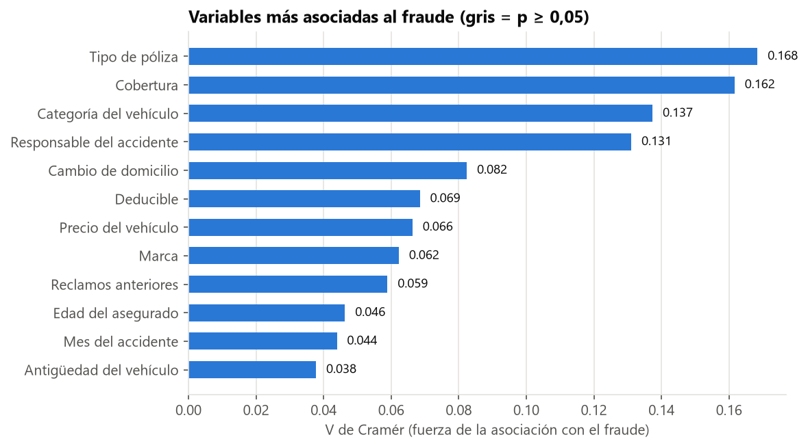
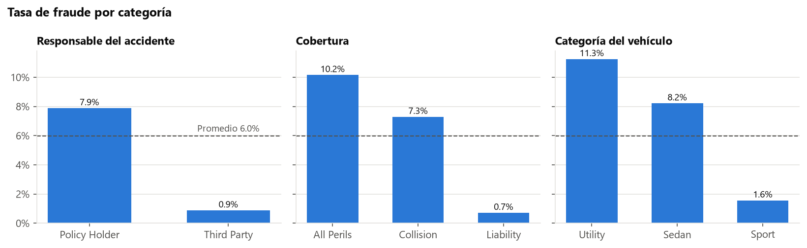
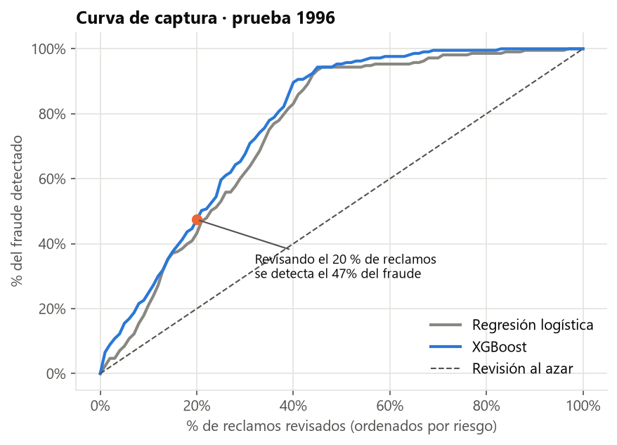
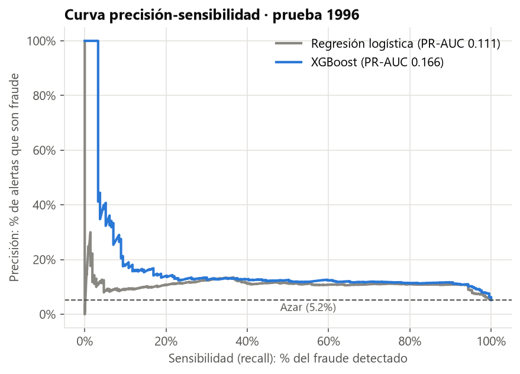
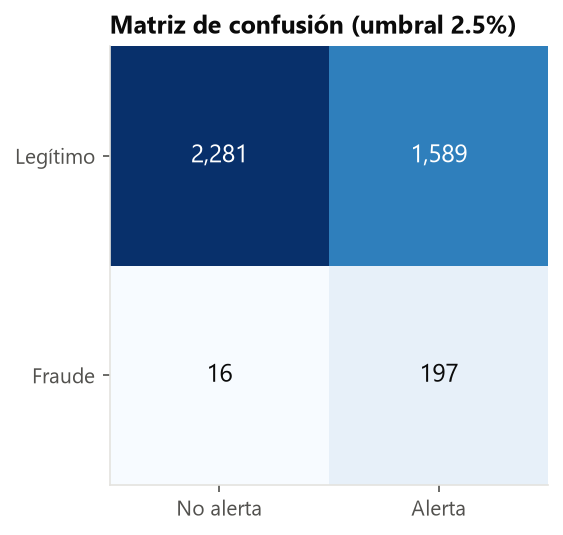
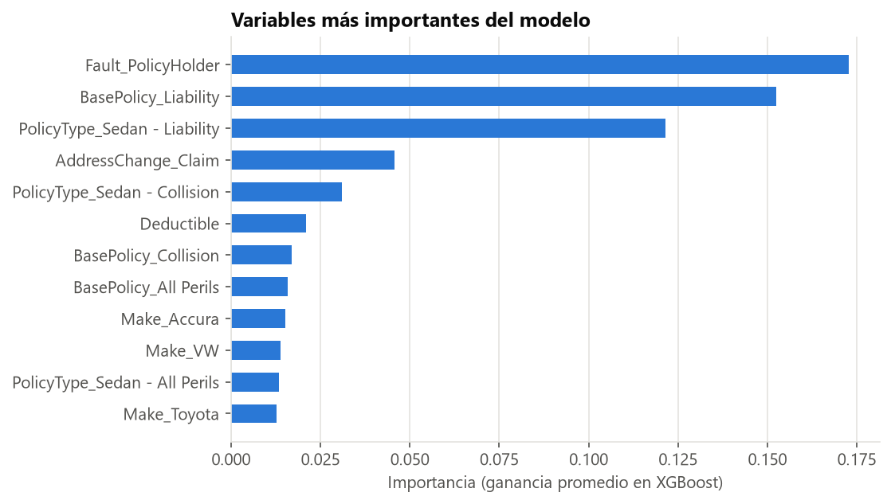

# Detección de fraude en reclamos de seguro vehicular


Modelo de clasificación que **prioriza qué reclamos investigar** en una aseguradora, entrenado con
**15 419 reclamos de un dataset público** en los que solo el **6 %** es fraude (datos muy desbalanceados).
Incluye análisis exploratorio con pruebas estadísticas, comparación de modelos, calibración de probabilidades,
elección del umbral por costo y una app interactiva en Streamlit.

> 🚀 **Demo en vivo:** [https://deteccion-fraude-seguros-nh6x7rc9wfjyb8wrujqsap.streamlit.app/](https://deteccion-fraude-seguros-nh6x7rc9wfjyb8wrujqsap.streamlit.app/) · también se ejecuta localmente con `streamlit run app/app.py`.

---

## 1. Problema de negocio

El área de siniestros no puede investigar todos los reclamos: cada revisión cuesta tiempo y dinero.
Pero dejar pasar un fraude significa pagar una indemnización indebida. La pregunta es:

> **¿Qué reclamos conviene investigar para detectar la mayor cantidad de fraude con el menor esfuerzo?**

## 2. Datos

- **Fuente:** [*Vehicle Insurance Claim Fraud Detection*](https://www.kaggle.com/datasets/shivamb/vehicle-claim-fraud-detection) (Kaggle), originalmente publicado por Oracle.
  Reclamos de seguro vehicular de 1994 a 1996, con 33 variables (póliza, vehículo, asegurado y siniestro).
- **Objetivo:** `FraudFound_P` (1 = fraude). **923 fraudes de 15 419 reclamos (5,99 %).**
- El CSV **no se incluye** en el repositorio: [`src/datos.py`](src/datos.py) lo descarga y verifica su hash SHA-256.

**Calidad de datos corregida**
- 1 registro con día y mes de reclamo inválidos ("0") → eliminado.
- 319 asegurados con `Age = 0` → marcados como faltantes. La variable de rango de edad sí está completa y se conserva.

## 3. Análisis exploratorio y estadística

Para cada variable categórica se aplicó la **prueba chi-cuadrado de independencia** (¿la tasa de fraude cambia según
la categoría más de lo que explicaría el azar?) y la **V de Cramér** (¿qué tan fuerte es la asociación?).
Con 15 mil filas casi todo sale significativo; la V permite ordenar por importancia práctica.




- Si el **asegurado** fue el responsable del accidente, el fraude llega al **7,9 %**. Si fue un tercero, baja al **0,9 %**.
- Las pólizas de solo **responsabilidad civil** (*Liability*) casi no tienen fraude (**0,7 %**), contra **10,2 %** en *All Perils*.
- El estado civil, el número de vehículos y la presencia de testigos **no** muestran asociación significativa (p > 0,05).

## 4. Método

| Decisión | Por qué |
|---|---|
| **Separación temporal:** entrenamiento con 1994–1995 (11 336 reclamos) y prueba con 1996 (4 083) | El modelo siempre se usará con reclamos futuros. Mezclar los años sobreestimaría el desempeño. |
| **Métrica principal: PR-AUC** (área bajo la curva precisión-sensibilidad) | Con 6 % de fraude, un modelo que nunca alerta tendría 94 % de exactitud y no serviría. |
| Rangos de texto (`"1 to 7"`, `"more than 30"`) → **números ordenados**; categorías → *one-hot* | Conserva el orden cuando lo hay ([`src/datos.py`](src/datos.py)). |
| **Línea base:** regresión logística con `class_weight="balanced"` | Punto de comparación simple e interpretable. |
| **XGBoost** con `scale_pos_weight` y búsqueda en malla con validación cruzada estratificada de 5 pliegues | Captura interacciones no lineales y compensa el desbalance. |
| **Calibración de Platt** | `scale_pos_weight` inflaba las probabilidades (un reclamo típico salía con 57 %). Tras calibrar, la probabilidad media en 1996 es 5,9 % frente a 5,2 % real. |
| **Umbral por costo mínimo**, elegido con predicciones fuera de pliegue del entrenamiento | La decisión depende del costo de cada error, no de un 50 % arbitrario. Supuesto: dejar pasar un fraude cuesta **20 veces** más que investigar. |

## 5. Resultados (prueba con reclamos de 1996, nunca vistos por el modelo)

| Modelo | ROC-AUC | PR-AUC | Fraude detectado revisando el 10 % / 20 % / 30 % |
|---|---:|---:|---:|
| Azar | 0,500 | 0,052 | 10 % / 20 % / 30 % |
| Regresión logística | 0,763 | 0,111 | 21 % / 43 % / 62 % |
| **XGBoost calibrado** | **0,790** | **0,166** | **25 % / 47 % / 68 %** |




**Con el umbral de costo mínimo (2,5 %):**



- Se detectan **197 de 213 fraudes (recall de 92,5 %)** investigando el **43,7 %** de los reclamos.
- La precisión es baja (11 %), pero es una decisión consciente: con un costo de 1 a 20, conviene investigar de más antes que pagar un fraude.
- El costo total baja **48,4 %** frente a la mejor alternativa sin modelo (investigar todo o no investigar nada).



Las variables más importantes coinciden con el EDA: responsable del accidente, tipo de cobertura y de póliza, y cambio de domicilio.

## 6. App interactiva

[`app/app.py`](app/app.py) tiene tres pestañas:
1. **Evaluar un reclamo:** formulario con 12 datos clave que devuelve la probabilidad de fraude, el riesgo frente al promedio y la recomendación (investigar o aprobar).
2. **Simulador de costos:** el usuario ingresa el costo de investigar y la pérdida por fraude, y la app recalcula el umbral óptimo, el % a investigar y el ahorro.
3. **Sobre el modelo:** métricas y gráficos de evaluación.

## 7. Cómo reproducirlo

```bash
python -m pip install -r requirements.txt
python src/datos.py          # descarga y verifica el dataset
python src/eda.py            # análisis exploratorio y pruebas chi-cuadrado
python src/entrenar.py       # entrena, evalúa y guarda el modelo en modelos/
streamlit run app/app.py     # abre la app en el navegador
```

## 8. Estructura

```
├── src/
│   ├── datos.py        Descarga, limpieza y preparación de variables
│   ├── eda.py          Análisis exploratorio, chi-cuadrado y V de Cramér
│   └── entrenar.py     Modelos, calibración, umbral por costo y gráficos
├── app/app.py          App de Streamlit
├── modelos/            Modelo entrenado y metadatos
├── resultados/         Tablas de asociación, importancia y predicciones de 1996
└── img/                Gráficos del README
```

## 9. Limitaciones y lecciones aprendidas

- **Hay deriva temporal:** la PR-AUC fue 0,25 en validación cruzada (1994–1995), pero 0,17 en 1996. Si se hubieran mezclado los años,
  el resultado reportado habría sido demasiado optimista. En producción, el modelo debería reentrenarse periódicamente.
- **Ordenar bien no es lo mismo que estimar bien la probabilidad.** Corregir el desbalance con pesos mejora el ranking, pero distorsiona
  los porcentajes. Por eso hay que calibrar antes de mostrar una "probabilidad" a un usuario de negocio.
- **El umbral es una decisión de negocio:** con otra relación de costos cambia el punto óptimo. Por eso el simulador está en la app.
- El dataset no incluye el monto del reclamo. Con ese dato, el costo de cada fraude podría ser individual en lugar de un promedio.

---

**Autor:** Julio García Jara · Estudiante de Ingeniería de Sistemas de Información (UPC) ·
[Portafolio](https://ego4men.github.io/Portafolio-Julio/) · [GitHub](https://github.com/ego4men)
